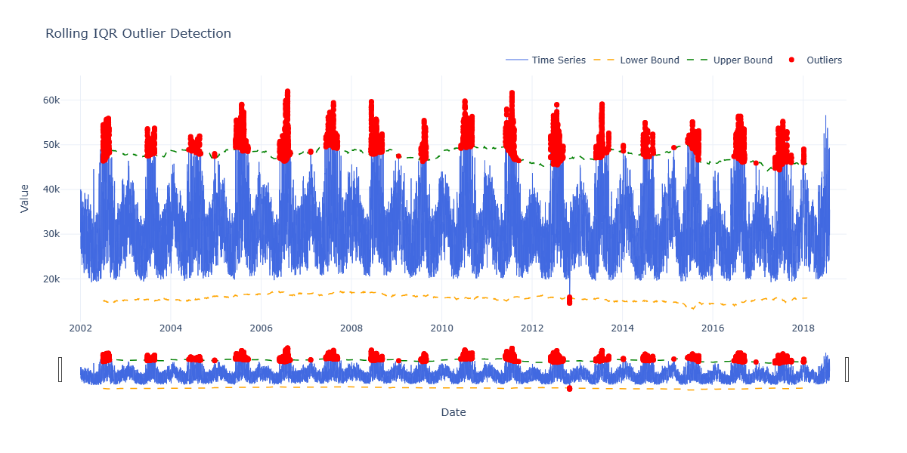

<div align="center">

# ⚡ Energy Consumption Forecasting

### Exploring Time-Series Data with Machine Learning

**From raw hourly power demand to feature engineering, model tuning, and forecasting.**

<br/>


</div>

---

## ✨ Project Overview

How can we use historical electricity demand to estimate future power consumption?

 

This project explores hourly electricity consumption data and builds machine learning models to predict power demand. It focuses on the complete workflow: data inspection, outlier analysis, time-based feature engineering, model comparison, hyperparameter tuning, and evaluation.

 

The notebook uses the **PJME hourly energy consumption** dataset. The target variable is `PJME_MW`, which represents electricity demand in megawatts.

> **Main goal:** build and compare regression models for hourly energy consumption using historical demand and time-based features.

## 🔍 What’s Inside?

The notebook is organized into the following stages:

| Stage | Description |
|---|---|
| 1. Data loading | Load the hourly dataset and prepare the datetime index. |
| 2. Outlier analysis | Detect unusual observations with a rolling Interquartile Range (IQR) method and inspect possible thresholds. |
| 3. Data cleaning | Apply the selected demand range and check missing values. |
| 4. Scaling | Standardize the target series using `StandardScaler`. |
| 5. Time-series splitting | Create chronological folds with `TimeSeriesSplit`. |
| 6. Feature engineering | Extract calendar features such as hour, weekday, month, quarter, year, and ISO week. |
| 7. Lag features | Add historical demand features, including yearly and daily lags. |
| 8. Visualization | Explore the time series, outliers, feature relationships, and validation folds. |
| 9. Model comparison | Compare regression algorithms with PyCaret. |
| 10. Model tuning | Search CatBoost hyperparameters with `GridSearchCV` and tune XGBoost with Optuna through PyCaret. |
| 11. Evaluation | Review residual, error, validation, and fold-based evaluation results. |
| 12. Prediction comparison | Compare selected models on a short, held-out date range from the dataset. |

## 🧠 Models and Tools

The notebook explores several regression algorithms, including:

- **Gradient Boosting Regressor**
- **CatBoost Regressor**
- **Extra Trees Regressor**
- **XGBoost Regressor**

Key libraries and tools:

- **Pandas & NumPy** — data preparation and numerical operations
- **Matplotlib, Seaborn & Plotly** — data visualization
- **Scikit-learn** — preprocessing, metrics, model selection, and time-series splitting
- **PyCaret** — model comparison, tuning, evaluation, and prediction
- **CatBoost & XGBoost** — gradient-boosting models
- **Optuna** — hyperparameter optimization

## 🛠️ Custom Functions

The notebook also includes reusable helper functions for common time-series tasks:

- `rolling_window_iqr()` — detects outliers using rolling quartiles.
- `number_outlier()` and `plot_outlier()` — inspect and visualize values outside selected boundaries.
- `plot_data_series()` — visualizes the training and validation windows created by `TimeSeriesSplit`.
- `create_features()` — extracts calendar features from a `DatetimeIndex`.
- `unique_index()` and `make_unique_df()` — inspect and handle duplicate timestamps.
- `report_irregular_gaps()` — reports gaps in the time index.
- `add_lag_data()` — creates yearly and daily lag features.
- `best_param_eval()` — inspects feature importance and selects features based on a threshold.
- `model_evaluation()` — displays model evaluation plots.
- `fold_model_test_eval()` and `step_by_step_eval()` — evaluate model predictions across time-series folds.

## 📊 Evaluation Metrics

The notebook uses two main regression metrics:

- **RMSE (Root Mean Squared Error):** measures the typical prediction error, with larger errors receiving more weight. Lower values are better.
- **R² (Coefficient of Determination):** measures how much of the target variance is explained by the model. Values closer to 1 generally indicate a better fit; the score can also be negative.

The notebook reports fold-level results and compares model predictions on a selected date range.

## 📁 Project Structure

```text
Energy-Consumption-Forecasting/
│
├── Energy_Consumption_Model.ipynb
├── PJME_hourly.csv
├── requirements.txt
└── README.md
```

`PJME_hourly.csv` is an input dataset and is not included in this repository by default. Place the CSV file next to the notebook before running it.

## 🚀 Getting Started

### 1. Clone the repository

```bash
git clone https://github.com/farshad257/Energy_Consumption_Modeling.git
cd Energy_Consumption_Modeling
```


### 2. Create and activate a virtual environment

```bash
python -m venv .venv
```

**Windows:**

```bash
.venv\Scripts\activate
```

**Linux / macOS:**

```bash
source .venv/bin/activate
```

### 3. Install the dependencies

```bash
pip install pandas numpy matplotlib seaborn plotly scikit-learn pycaret catboost xgboost optuna jupyter
```

### 4. Add the dataset

Put `PJME_hourly.csv` in the project directory. The notebook expects this relative path:

```python
pd.read_csv("./PJME_hourly.csv")
```

### 5. Run the notebook

```bash
jupyter notebook Energy_Consumption_export.ipynb
```

Run the cells in order. Some cells perform model comparison and hyperparameter search, so execution may take time depending on your hardware and selected settings.

## ⚠️ Notes and Limitations

- The notebook expects the input CSV to be available locally; the dataset is not bundled here.
- The reported model comparison depends on the selected data, preprocessing, feature set, and evaluation period. A model that performs best on one selected period is not guaranteed to be the best on other periods.
- Some notebook evaluation cells use an already-fitted model on time-series folds. For an unbiased cross-validation estimate, clone and retrain the estimator within each fold, then predict the corresponding future validation segment.
- Lag features are only valid when their source observations would actually be available at the forecast time. The correct lag strategy depends on the intended forecast horizon.

These points are important when interpreting the scores or adapting the notebook for a production forecasting system.

## 🔮 Possible Next Steps

- Add a leakage-safe preprocessing pipeline for each time-series fold.
- Compare models on a separate final chronological test set.
- Add prediction intervals and residual diagnostics.
- Test direct multi-step forecasting strategies.
- Add deep learning models such as LSTM or temporal convolutional networks if needed.

## 📄 License

This project is released under a modified MIT License that allows free use, modification, and distribution, provided that proper credit is given to the original author and source.
See the [LICENSE](LICENSE) file for details.

---

<div align="center">

**If you find this project useful, feel free to ⭐ the repository.**

Built with Python and a curiosity for data.

</div>
